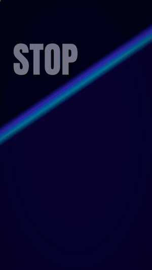
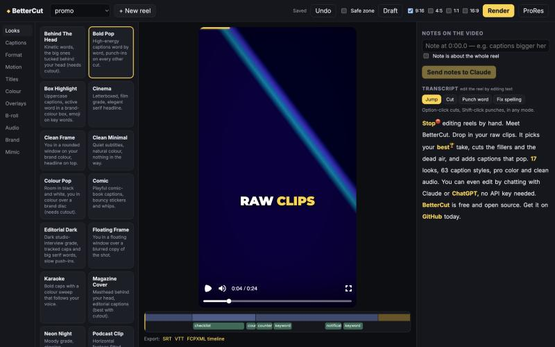

# BetterCut

**Raw clips in. Finished reel out.** A free, open-source editor for short vertical video (Reels, Shorts, TikTok).
It cuts your footage, captions it, styles it, and lets you edit by chatting with the AI app you already pay for.

<p align="center">
  
</p>

This demo was cut, captioned and rendered by BetterCut itself. [Watch it with sound](docs/bettercut-demo.mp4).



## What it does

- **Cuts for you.** Transcribes your clips, keeps the last clean take of every repeated line, and removes fillers and dead air.
- **Edit by editing text.** Click a word to cut it, punch it up or fix its spelling. The video follows.
- **Timeline.** Split at the playhead, drag a shot's edges to trim, delete and reorder shots, freeze a frame, set a shot's speed or apply a speed ramp, pick a transition for each cut, play a shot in reverse, drag overlays and b-roll to move or resize them, scrub and zoom.
- **Keyframes.** Animate an overlay's position, size, rotation and opacity, or a shot's zoom and focus point, between keyframes you set on the timeline.
- **Translated captions.** Add a second language, one line per sentence. Show both languages or the translation only. Type the lines yourself or ask your AI to translate the reel.
- **Beat markers.** Add music and the timeline shows its beats. The playhead and trimmed cuts snap to them, and one click cuts a shot on every beat, every second beat or every fourth.
- **Camera log footage.** Pick Apple Log, Sony S-Log3 or Panasonic V-Log and the flat picture is converted to normal colour.
- **Green screen.** Remove a flat backdrop, with the colour found for you, and put any background behind the subject.
- **Record in the browser.** Film yourself with a teleprompter that scrolls your script, or record a voiceover from your microphone while the reel plays. Voiceovers sit on their own track and the music ducks under them.
- **Media layers.** Put extra video, images and sound on their own tracks above the footage. Place, size, turn, fade and keyframe each one, and change which is in front.
- **Add clips later.** Append more footage to a reel you have already edited; only the new clips are transcribed.
- **Captions and style.** 17 looks, 63 caption styles, 16 layouts, 61 motion effects, 13 opening titles, 19 animated overlays.
- **Pro finish.** Colour grades and LUTs, voice clean-up, loudness for social, sound effects, face-aware framing.
- **Any shape.** Render 9:16, 4:5, 1:1 and 16:9 from one edit. Export SRT, VTT and an FCPXML timeline.
- **Works without a voice.** Clips with no speech (b-roll, music, screen recordings) become reels too.
- **Mimic.** Point it at a reference reel and it builds a matching look.
- **Edit from Claude or ChatGPT, with no API key.** BetterCut is an MCP connector: your AI app calls its editing tools and the open editor updates live.
- **Remembers you.** Spellings, style rules and defaults carry over to every new reel. The AI can only suggest a memory; you approve it.
- **Runs on your machine.** Speech recognition is local. Your footage is not uploaded anywhere.

## Quick start

You need Python 3.10+, Node 22+ and ffmpeg.

```bash
git clone https://github.com/PriyanshMathur1/bettercut.git
cd bettercut
./scripts/setup.sh
.venv/bin/python -m bettercut ui
```

Open http://localhost:4790, click **New reel** and drop in a clip. The first run downloads the speech model (about 500 MB).

Prefer the command line:

```bash
.venv/bin/python -m bettercut make my-reel ~/Videos/clip.mp4 --look bold-pop
.venv/bin/python -m bettercut render my-reel --quality high --aspect all
```

Projects are saved in `~/bettercut-projects`. Run `python -m bettercut --help` for every command.

## Edit by chatting (no API key)

Start the multi-user build of the editor, which includes the connector:

```bash
.venv/bin/python -m bettercut cloud --port 4795
```

Then add `http://localhost:4795/mcp` to an AI app on the same computer. With Claude Code:

```bash
claude mcp add --transport http bettercut http://localhost:4795/mcp
```

Keep the editor open at http://localhost:4795 and ask for an edit, for example: "List my reels, then tighten the pauses in
the latest one and make the hook a question." Each change appears in the editor and is one Undo step.

Hosted AI apps (Claude.ai, ChatGPT) can only reach a public HTTPS site. For those, deploy BetterCut and give each user their
personal connector link from **Settings > Connect your AI**.

If you would rather use an API key, the Notes box in the editor works with Anthropic, OpenAI, Gemini, OpenRouter or any
OpenAI-compatible endpoint. Keys are encrypted at rest.

## Host it for others

`bettercut/deploy/` has a Docker image, HTTPS through Caddy and a step-by-step guide for a free server:
[DEPLOY.md](bettercut/deploy/DEPLOY.md). Sign-in is Google only, through Supabase. Each person sees only their own reels.

## How it works

- `bettercut/` is the Python pipeline: transcription (faster-whisper + whisperX alignment), auto-cut, colour, audio, export,
  the local editor server, and `cloud/` for the hosted version (accounts, job queue, storage, connector).
- `composer/` is the renderer and the editor: a [Remotion](https://www.remotion.dev) composition driven by one JSON spec,
  and a React editor that previews the same composition.
- The whole edit is one `spec.json`. People, the editor and AI tools all change the reel by changing that file.
  [SKILL.md](bettercut/SKILL.md) documents every field.

## Tests

```bash
.venv/bin/pip install -r requirements-dev.txt
.venv/bin/python -m pytest tests -q
cd composer && npm test
```

## Status

This is a young project. What has been checked and what has not:

- Checked: the pipeline, editor and renders on macOS (Apple Silicon); 92 Python tests and 43 Node tests.
- Not yet checked: the Docker image has not been built, hosted Google sign-in has not been run against a live Supabase
  project, and the connector has been exercised with direct calls only, not yet from Claude.ai or ChatGPT.

Issues and pull requests are welcome.

## Licences you should know about

- BetterCut's own code is MIT licensed. See [LICENSE](LICENSE).
- **Remotion** (the renderer) has its own licence. It is free for individuals and for companies of up to three people; larger
  companies need a paid Remotion licence. See https://www.remotion.dev/license.
- The whisperX alignment models for French, German, Spanish and Italian are licensed for non-commercial use.
- Fonts are loaded from Google Fonts under their open licences.
